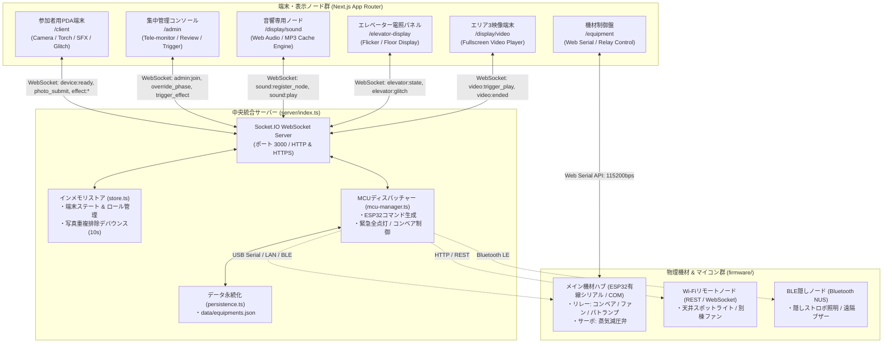

# 2026 祇園祭 工場点検ホラーアトラクション 統合制御システム

本リポジトリは、文化祭・展示イベントにおけるホラーアトラクションの運営を支える統合制御システムです。  
参加者が携帯する **「保守用PDA端末 (Web)」**、スタッフが操作する **「集中管理コンソール (Admin)」**、会場内各所に分散配置される **「音響専用ノード (Sound Node)」**、**「エレベーター階数電照パネル」**、**「大型映像モニター」**、および物理ギミック（搬送コンベア、蒸気弁サーボ、非常パトランプ、排煙ファン等）を駆動する **「ESP32マイコン」** をリアルタイムに連携制御します。

Next.js (App Router) + TypeScript + Socket.IO によるフルスタック構成で、レトロ業務機（Windows 95/98 Classic）調の硬質かつ統一されたUIデザインを採用しています。

---

## 1. システム全体アーキテクチャ概要

### A. 全体連携データフロー図



### B. 各ノードの役割分担

| ノード種別 | エンドポイント | 主な責務と機能 |
|---|---|---|
| **参加者用PDA端末** | `/client` | 進行フェーズ同期、点検ミッション撮影（Canvasリサイズ圧縮）、画面グリッチ妨害演出、背面トーチ明滅、プロシージャル効果音再生、オフライン再接続ダイアログ |
| **集中管理コンソール** | `/admin` | 全PDA/音響端末のリアルタイム監視（バッテリー・通信・フェーズ）、写真合否審査、フェーズ強制進行、全館恐怖演出の一斉発火、非常用全点灯スイッチ |
| **音響専用ノード** | `/display/sound` | 会場内の隠しスピーカー・天井スピーカー接続端末。Autoplay制約のワンタップ解除、プロシージャル合成音およびMP3キャッシュ再生 |
| **エレベーター電照パネル** | `/elevator-display` | 段ボール筐体くり抜き用の暖色発光バックライト電照板。蛍光灯チラつきグリッチ演出、1F/B1F表示切替 |
| **エリア3大型映像端末** | `/display/video` | フルスクリーン動画再生プレイヤー。走査線待機画面からWebSocketシグナルにより即座にホラー動画を再生 |
| **機材演出制御盤** | `/equipment` | Web Serial APIを用いたマイコン直結制御、COMポート自動検出、リレー/サーボの個別ON/OFFテスト |

---

## 2. ディレクトリ構成とモジュール責務

```text
2026gionsai2/
├── certificates/             # HTTPS用SSL証明書配置ディレクトリ (cert.pem, key.pem)
├── data/
│   └── equipments.json       # 機材定義・ピンアサイン永続化ファイル
├── docs/                     # 各種外部API仕様書 (FLASHLIGHT_API.md等)
├── firmware/                 # ESP32マイコン向けArduinoスケッチ
│   ├── README_HARDWARE.md    # ハードウェア配線仕様・AIコード生成プロンプト
│   ├── esp32_relay_hub/      # 【有線USBシリアル統合メインハブ】リレー4ch + サーボ
│   ├── esp32_wifi_hub/       # 【Wi-Fiリモートノード】REST APIサーバー
│   └── esp32_ble_hub/        # 【BLE隠しノード】Nordic UART Service
├── public/                   # 静的公開アセット
│   ├── audio/                # MP3/WAV音声アセット配置場所 (Git管理対象外、.gitkeepのみ保持)
│   ├── videos/               # 演出用動画ファイル配置場所 (Git管理対象外)
│   └── cast-manual.pdf       # 管理画面でインライン閲覧する運営スタッフマニュアル
├── server/                   # バックエンド・リアルタイムWebSocketサーバー
│   ├── index.ts              # Express + Socket.IO + Next.js カスタムサーバー
│   ├── store.ts              # インメモリストア (端末・審査キュー・機材状態管理)
│   ├── persistence.ts        # equipments.json のファイルI/O
│   └── mcu-manager.ts        # ハードウェア通信プロトコルブリッジ
└── src/                      # フロントエンド (Next.js 14 App Router)
    ├── app/                  # 各種画面ルーティング
    │   ├── admin/page.tsx    # 集中管理コンソール画面
    │   ├── client/page.tsx   # 参加者用PDA端末画面
    │   ├── display/
    │   │   ├── sound/page.tsx # 音響専用ノード画面
    │   │   └── video/page.tsx # エリア3映像再生端末画面
    │   ├── elevator-display/ # エレベーター階数表示画面
    │   ├── equipment/        # 機材制御盤画面
    │   ├── layout.tsx        # アプリ全体共通ルートレイアウト
    │   └── page.tsx          # 統合ポータルランチャー画面
    ├── components/           # UIコンポーネント群
    │   ├── admin/            # 端末監視、写真審査、演出発火パネル
    │   ├── client/           # 各エリア演出、カメラ撮影、グリッチキャンバス
    │   ├── common/           # 全画面切替、オフライン再接続モーダル (ReconnectingModal)
    │   └── equipment/        # Web Serial設定ダイアログ、機材カード
    ├── hooks/                # カスタムフック
    │   ├── useSocket.ts      # WebSocket接続・切断・再接続監視
    │   ├── useSoundEngine.ts # 音響エンジンラッパーフック
    │   ├── useTorch.ts       # ネイティブBridge / Web Camera トーチ制御
    │   └── useBattery.ts     # バッテリー残量テレメトリ監視
    ├── lib/                  # コアロジック・共通ユーティリティ
    │   ├── soundEngine.ts    # Web Audio API シンセサイザー & MP3キャッシュ再生
    │   ├── types.ts          # システム全域のTypeScript型定義・イベント規約
    │   └── webSerial.ts      # Web Serial API 通信ラッパー (排他ロック安全解放機構)
    └── styles/               # CSSスタイル定義 (win95.css, glitch.css, admin.css等)
```

---

## 3. 通信プロトコル・演出イベント仕様

### A. Socket.IO イベント規約 (`src/lib/types.ts`)

#### サーバー受信イベント (`ClientToServerEvents`)

| イベント名 | 送信元 | ペイロード / 引数 | 説明 |
|---|---|---|---|
| `device:ready` | クライアント / 全端末 | `{ deviceId, phase, location?, role? }` | 端末接続時の初期登録およびロール（`client`, `sound_node`等）通知 |
| `sound:register_node` | サウンドノード | `{ deviceId, location? }` | 音響専用ノードとしての明示的登録と `sound_nodes` ルーム参加 |
| `sound:trigger` | 管理コンソール | `SoundNodePlayPayload` | サウンドノードまたは全端末への効果音・MP3ファイル再生指示 |
| `task:photo_submit` | PDA端末 | `{ deviceId, taskId, taskTitle, imageBase64 }` | 点検写真の提出（10秒間の重複排除デバウンス付き） |
| `elevator:trigger_move` | PDA / 管理 | `{ from?, to?, deviceId? }` | 1FからB1Fへのエレベーター下降演出シーケンスの開始 |
| `conveyor:control` | PDA / 管理 | `{ action: 'forward'\|'reverse'\|'stop', speed? }` | 搬送コンベアの動作指示（ESP32へ即時中継） |
| `admin:trigger_effect` | 管理コンソール | `{ targetDeviceId?, effectType, options }` | グリッチ妨害、トーチ点滅、音響演出の手動強制発火 |
| `admin:emergency_all_light` | 管理コンソール | なし | 全非常照明・全端末トーチの一斉強制点灯およびコンベア緊急停止 |

#### クライアント受信イベント (`ServerToClientEvents`)

| イベント名 | 受信先 | ペイロード | 説明 |
|---|---|---|---|
| `phase:update` | PDA端末 | `{ phase: DevicePhase, deviceId? }` | 進行フェーズの切り替え通知 |
| `effect:glitch` | PDA端末 | `GlitchEffectOptions` | 画面歪み・色反転・砂嵐などの妨害演出トリガー |
| `effect:torch` | PDA端末 | `TorchEffectOptions` | 怪異点滅（`pattern: '1,0,0,1,0,0,1'`）や高速明滅の実行 |
| `effect:sound` | PDA端末 | `SoundEffectOptions` | プロシージャル効果音またはMP3ファイル再生 |
| `sound:play` | サウンドノード | `SoundNodePlayPayload` | 指定音源（プロシージャルまたはMP3）の即時再生 |
| `elevator:state` | エレベーター表示 | `{ floor, glitch? }` | 階数表示（FLOOR_1 / MOVING / FLOOR_B1）の更新 |
| `admin:state_sync` | 管理コンソール | `{ devices, submissions, equipments, ... }` | 全接続端末・機材状態のリアルタイム一括同期 |

---

### B. 音響エンジン (`soundEngine.ts`) 仕様

システムは **2系統の音響出力方式** を併用します：

```
[ 音響再生要求 ]
     ├── プロシージャル合成音 (soundType: 'beep' | 'lowImpact' | 'geiger' | 'drone' ...)
     │     └── 外部ファイル不要。オシレーター・ノイズ・リバーブ・コンプレッサーを動的生成。
     │
     └── 外部MP3ファイル再生 (soundType: 'file', filename: 'alarm.mp3')
           └── public/audio/ 配下から初回fetchしてAudioBufferCacheにデコード保存。2回目以降は即座にゼロ遅延再生。
```

#### 音声アセットの追加と再生手順
1. `public/audio/` ディレクトリ内にMP3またはWAVファイル（例: `warning_siren.mp3`）を配置します。
2. 管理コンソールの「MP3ファイル再生」入力欄にファイル名（`warning_siren.mp3`）を入力して実行するか、コード内から呼び出します：
   ```typescript
   // クライアント側フック経由の呼び出し例
   const { playAudioFile } = useSoundEngine();
   await playAudioFile('warning_siren.mp3', { volume: 1.5, loop: false });
   ```
3. **ブラウザのAutoplayポリシー対策**:
   - Web Audio APIはユーザーの初回インタラクション（タップ・キー押下）がないと音声を鳴らすことができません。
   - サウンドノード端末（`/display/sound`）では、画面上に **「タップして音響ノードを有効化」** ボタンを表示し、事前に `AudioContext.resume()` を実行して待機状態を確立します。

---

### C. ESP32マイコン通信仕様 (JSON / シリアル)

管理画面の機材制御盤（`/equipment`）またはサーバーの `mcu-manager.ts` から、ESP32宛てに **改行コード (`\n`) で区切られた1行のJSON** を送信します。

#### コマンド送信フォーマット
```json
{"action":"conveyor","state":true,"power":1,"direction":"forward","speed":100}
{"action":"valve","state":true,"power":1}
{"action":"emergency","state":true,"power":1}
{"action":"all_off"}
```

#### ESP32ファームウェア側の解析仕様 (`firmware/esp32_relay_hub/esp32_relay_hub.ino`)
- 高速かつ省メモリに処理するため、文字列検索（`indexOf`）による軽量パーサーを実装しています：
  - `cmd.indexOf("emergency") >= 0` -> リレー3（パトランプ）ON、リレー1（コンベア）OFF
  - `cmd.indexOf("conveyor") >= 0` -> リレー1（GPIO 23）制御
  - `cmd.indexOf("valve") >= 0` -> サーボモーター（GPIO 18）を90度回転（減圧弁開放）
  - `cmd.indexOf("fan") >= 0` -> リレー2（GPIO 22）制御

---

## 4. 開発・実行・改修ガイド

### A. セットアップと起動手順

#### 1. 前提条件
- Node.js 18.x 以上 (Node.js 20.x 推奨)
- npm または yarn

#### 2. インストール
```bash
npm install
```

#### 3. 開発サーバー起動
```bash
npm run dev
```
`tsx server/index.ts` が実行され、Express + Socket.IO サーバーと Next.js App Router が同一ポート（デフォルト: `3000`）で立ち上がります。

#### 4. HTTPS (SSL) の設定（カメラ・トーチ・Web Serial の動作に必須）
ローカルLAN内の別端末（スマホ等）からカメラやトーチを使用する場合、ブラウザのセキュリティ制限により **HTTPSが必須** となります。  
プロジェクトルートに `certificates/` フォルダを作成し、自己署名証明書等を配置すると自動的にHTTPSサーバーとして起動します：
```text
certificates/
├── cert.pem   # SSLサーバー証明書
└── key.pem    # 秘密鍵
```

---

### B. 演出・機能改修の指針 (How-To)

#### 1. 新しい演出フェーズを追加する場合
1. `src/lib/types.ts` の `DevicePhase` 型に新しいフェーズ名を追加します：
   ```typescript
   export type DevicePhase = 'STANDBY' | 'AREA_1_PHOTO' | 'ELEVATOR' | 'AREA_2_CONVEYOR' | 'AREA_3_VIDEO' | 'NEW_PHASE' | 'RETURN';
   ```
2. `src/components/client/` 配下にフェーズごとのUIコンポーネント（例: `PhaseNewGimmick.tsx`）を作成します。
3. `src/app/client/page.tsx` のフェーズ描画スイッチ文にコンポーネントを追加します。
4. `src/components/admin/EffectTriggerPanel.tsx` および `DeviceMonitor.tsx` のフェーズ切り替えUIに新しいフェーズボタンを追加します。

#### 2. 新しいMP3音声を追加する場合
1. 音声ファイル（`.mp3`）を `public/audio/` に配置します（例: `public/audio/monster_growl.mp3`）。
2. 管理画面（`/admin`）の「MP3ファイル再生」入力欄に `monster_growl.mp3` を入力して再生テストを行います。
3. プログラム内から自動トリガーさせたい場合は、サーバー側の目的のイベントハンドラー内で以下を発行します：
   ```typescript
   io.emit('sound:play', {
     soundType: 'file',
     filename: 'monster_growl.mp3',
     volume: 1.5,
   });
   ```

#### 3. 新しい物理リレー/ギミックを追加する場合
1. `firmware/esp32_relay_hub/esp32_relay_hub.ino` のピン定義に空きGPIO（例: GPIO 19）を割り当て、`processCommand()` 内に分岐処理を追加します。
2. `server/mcu-manager.ts` の `handleMachineControl()` 内で、新しい機材IDに対する `action` 文字列（例: `"smoke_machine"`）を設定します。
3. 機材制御画面（`/equipment`）から機材アイテムを追加・保存します。

---

### C. 静的検査と品質・コーディング規約

#### 1. 型安全性の維持
コードを変更した後は、必ず TypeScript 型検査を実行してエラーが0件であることを確認してください：
```bash
npx tsc --noEmit
```

#### 2. 絵文字使用の禁止（硬質・インダストリアルUIの維持）
- コード内およびUI上に絵文字（例: ⚠️, 🔊, 🔌, ❌, 💡 など）を直接記述しないでください。
- 代替として、角括弧で囲んだテキストバッジ（例: `[SOUND]`, `[DISCONNECTED]`, `[DETECTED]`）や、CSSによるシンプルなステータスインジケーター（`.dot.online`）を使用してください。

#### 3. Hydration Error（SSR不一致）の防止
- ブラウザ専用API（`window`, `navigator.onLine`, `localStorage` 等）に基づく表示切り替えを行うコンポーネントには、必ずマウント完了フラグ（`isMounted`）を配置してください。
- タイムスタンプやランダムIDをSSR初期描画時に直接埋め込まず、初期描画時は固定プレースホルダー（`----`）を表示した上で `useEffect` 内で更新してください。

---

## 5. ライセンス・著作権

本プロジェクトは 2026年 祇園祭・文化祭展示専用に設計・制作された演出統合制御システムです。  
ポータル画面（`/`）最下部の「ライセンス・著作権表記を表示」から、利用オープンソースライブラリの一覧および権利条項を確認できます。
