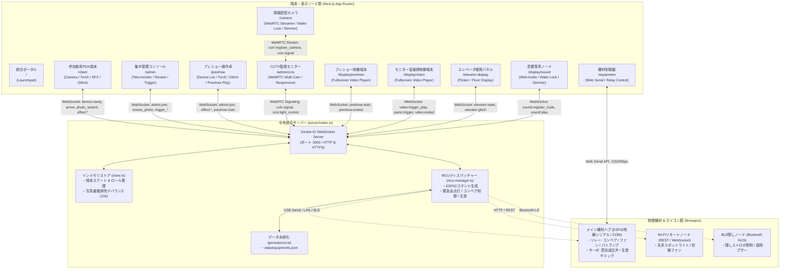

# 2026 祇園祭 工場点検ホラーアトラクション 統合制御システム

本リポジトリは、文化祭・展示イベントにおけるホラーアトラクションの運営を支える統合制御システムです。  
参加者が携帯する **「保守用PDA端末 (Web)」**、スタッフが操作する **「集中管理コンソール (Admin)」**、現場状況を常時中継する **「CCTV監視カメラ」**、会場内各所に分散配置される **「音響専用ノード (Sound Node)」**、**「プレショー上映スクリーン」**、**「エレベータ階数電照パネル」**、**「モニター室大型映像プロジェクター」**、および物理ギミック（搬送コンベア、蒸気弁サーボ、非常パトランプ、排煙ファン、生首ギミック等）を駆動する **「ESP32マイコン」** をリアルタイムに連携制御します。

Next.js (App Router) + TypeScript + Socket.IO によるフルスタック構成で、レトロ業務機（Windows 95/98 Classic）調の硬質かつ統一されたUIデザインを採用しています。

---

## 1. システム全体アーキテクチャ概要

### A. 全体連携データフロー図



### B. 提供画面・URLエンドポイント一覧

| ノード種別 | エンドポイント | 主な責務と機能仕様 |
|---|---|---|
| **統合ポータル** | `/` | 各種サイネージ、PDA端末、管理画面、操作卓へのダイレクト起動リンク集。全画面のヘッダーナビゲーションを整理し、「アトラクション・現場端末」「管理・監視・演出操作卓」「空間演出・音響・物理機材」の3分類で整理。 |
| **参加者用PDA端末** | `/client` | 現場巡視保守員向けスマホ画面。**スマホ側での動画再生を完全排除**し、「安全規定同意」➔「エリア1到着確認」➔「指定資料撮影・送信」の超軽量・高安定動作フローを採用。背面トーチ（LED）、画面グリッチ、警告バイブレーション、オフライン自動復帰ダイアログを完備。 |
| **集中管理コンソール** | `/admin` | 運営スタッフ向け集中管理画面（3カラムレスポンシブ構成）。全PDA端末・サイネージのリアルタイム監視（バッテリー残量・充電状態・通信リンク・現在フェーズ）、提出写真の即時合否審査、全館恐怖演出の一斉発火、非常用全点灯スイッチ。 |
| **プレショー操作卓** | `/preshow` | 待機ホール・プレショー担当スタッフ向け専用コンソール。スマートフォンやタブレットからの操作に対応。接続端末一覧（バッテリー・充電状況・リンク監視）、一括および個別端末へのフラッシュライト遠隔制御（点滅・点灯・消灯）、画面グリッチ妨害、プレショー映像の再生開始スイッチ、直近操作ログを提供。 |
| **監視カメラCCTV** | `/admin/cctv` | 現場各所（品質管理室/通路・EV前/製造ライン）に設置されたカメラ端末からのWebRTC P2P低遅延映像監視モニター。小型端末から大型ディスプレイまで柔軟に対応するレスポンシブグリッドレイアウト（モバイル1列、3分割時は画面下端まで最大表示）。不要なQRコード表示を排した即時監視UI。 |
| **現場配信カメラ** | `/camera` | 会場内に定置または携行する監視カメラ配信用端末画面。背面カメラ映像のWebRTC常時中継、フラッシュライト遠隔受動制御、端末の自動スリープを防止する **Wake Lock API常時稼働**、および暗所での光漏れを防ぐ **Web画面調光オーバーレイ（標準 / 減光 / 超減光）** を搭載。 |
| **プレショー映像端末** | `/display/preshow` | 待機ホール正面スクリーン用フルスクリーン動画再生プレイヤー。CRTスキャンライン待機画面、ブラウザAutoplay制限解除オーバーレイ、管理卓または操作卓からの `preshow:start` トリガー受信、映像終了（`ended`）時のサーバー通知連動（`preshow:ended`）。 |
| **エレベータ電照パネル** | `/elevator-display` | 段ボール筐体くり抜き用の上下2分割全画面発光電照板。遠隔バッテリー監視連携、蛍光灯チラつきグリッチ演出、1F/B1F表示切替、降下中消灯シーケンス。 |
| **モニター室最終映像端末** | `/display/video` | エリア3（モニター室）大型プロジェクター/モニター用フルスクリーン再生プレイヤー。怪異出現タイムスタンプ（5.0秒）検知による全館パニック連動（`panic:trigger`）およびプロシージャルホラー音響フォールバック。 |
| **音響専用ノード** | `/display/sound` | 会場内の隠しスピーカー・天井スピーカー接続端末。Autoplay制約のワンタップ解除、プロシージャル合成音およびMP3キャッシュ再生。暗所設置に対応する **Wake Lock API画面消灯防止** および **Web画面調光オーバーレイ** を完備。 |
| **機材演出制御盤** | `/equipment` | Web Serial APIを用いたESP32マイコン直結制御、COMポート自動検出、リレー/サーボの個別ON/OFFテスト。 |

---

## 2. 体験シナリオ（全5フェーズ構成）

本アトラクションは、参加者が点検員として廃工場（第零製造区画）に潜入し、異常事態に巻き込まれて脱出する全5段階のシナリオで構成されています。

```
[受付 / スタート]
       │
       ▼
【① プレショー】 ───────── 待機ホール正面スクリーンでガイダンス上映（PDAは動画非再生）
       │                    ※上映終了と同時にPDAへ通知音・振動が届く
       ▼
【② 品質管理室】 ───────── PDA「エリア1到着」 ➔ 資料撮影 ➔ スタッフ審査・承認 ➔ EVへ移動
       │
       ▼
【③ エレベーター】 ──────── 扉閉鎖 ➔ 降下演出（階数電照パネル急降下 + 照明明滅 + PDA暗転） ➔ B1F到着
       │
       ▼
【④ 製造ライン】 ───────── PDA「製造ライン到着」 ➔ コンベア自動駆動 ➔ コンベア撮影 ➔ 承認直後に生首ギミック作動！
       │
       ▼
【⑤ モニター室】 ───────── 逃走入室 ➔ 最終映像上映 ➔ 怪異出現・照明全消灯 ➔ キャスト飛び出し ➔ 非常脱出！
```

### ① プレショー (待機ホール)
- **演出連動**: 待機ホール正面スクリーン（`/display/preshow`）にて、管理卓または手動操作により「保安点検ガイダンス映像」をフルスクリーン上映します。
- **PDA端末**: 動画再生は一切行いません。「安全規定への同意」を行った後、待機ホールでガイダンス終了を待ちます。
- **フェーズ完了**: スクリーン側の映像終了（`ended` イベント）を検知すると、サーバーから全PDA端末へ点検開始通知（バイブレーション＋低音衝撃音響＋画面グリッチ）が自動発行され、PDAが「品質管理室へ向かってください」の案内に切り替わります。

### ② 品質管理室 (エリア1撮影点検)
- **PDA操作**: 参加者は1F通路を進んで品質管理室へ入室し、PDAの「エリア1（品質管理室）に到着した [点検開始]」ボタンをタップします。
- **点検ミッション**: 室内に残された指定資料（点検書類等）をカメラで撮影し、管理卓へ送信します。写真は端末側Canvasで長辺1280px/WebPに軽量圧縮され即座にアップロードされます。
- **スタッフ審査**: 管理画面（`/admin`）の写真審査キューにリアルタイム表示され、スタッフが「合格（APPROVED）」または「差戻し（REJECTED）」を判定します。合格するとPDAに「点検完了」が表示され、エレベーターへの移動指示が出ます。

### ③ エレベーター (1F ➔ B1F 降下シーケンス)
- **演出連動**: 参加者がエレベーター筐体に入室後、PDAまたは管理画面から「降下シーケンス開始」を実行します。
- **複合恐怖演出**:
  1. 扉閉鎖音とともにエレベーター電照パネル（`/elevator-display`）の1階ランプが消灯。
  2. 重低音のモーター降下音とケーブル軋み音が出力され、電照パネルが激しくフリッカー点滅。
  3. 同時に現場の照明が明滅し、PDA端末も激しい画面グリッチ（砂嵐・色反転）と怪異トーチ点滅（`pattern: '1,0,0,1,0,0,1'`）を実行。
  4. 降下完了とともに「B1F」ランプが点灯し、PDA画面に「第④フェーズ（製造ライン）へ進む」ボタンが表示されます。

### ④ 第零製造ライン (コンベア点検 ＆ 生首ジャンプスケア)
- **物理機材連携**: 参加者が地下の製造ラインに到着してボタンを押すと、ESP32マイコン経由で搬送コンベアのリレーが通電し、ベルトコンベアが自動起動します（6秒間デモ駆動）。
- **点検ミッション**: 稼働したベルトコンベアの異常有無を写真撮影し、管理卓へ送信します。
- **ジャンプスケア発火**: スタッフが写真を承認した瞬間、警告サイレン・悲鳴とともにコンベア奥から**「怪異生首ギミック」**がサーボ/ソレノイドにより突如飛び出します。
- **避難指示**: PDA端末の背面トーチが高速ストロボ発光し、画面が深紅のアラート表示に変化。「直ちに逃げてください！モニター室へ移動せよ」と退避命令が下ります。

### ⑤ モニター室 ＆ パニック非常脱出 (クライマックス)
- **映像上映**: 参加者がモニター室へ逃げ込み、プロジェクター（`/display/video`）にて最終記録映像の上映を開始します。
- **怪異出現・同期パニック**: 映像の再生から指定秒数（5.0秒）が経過した瞬間、映像内の怪異出現と完全に同期して `panic:trigger` が発行されます。
- **キャスト突入**: 会場全体の現場照明が強制遮断（暗転）され、キャスト（お化け役）が扉を開けて部屋へ突入。
- **非常脱出**: PDA端末が赤色ストロボ点滅＋非常警報音を鳴らし、「出口へ逃げろ！扉から脱出してください」と誘導。地上受付へ脱出して端末を返却し、体験終了となります。

---

## 3. ディレクトリ構成とモジュール責務

```text
2026gionsai2/
├── certificates/             # HTTPS用SSL証明書配置ディレクトリ (cert.pem, key.pem)
├── data/
│   └── equipments.json       # 機材定義・ピンアサイン永続化ファイル
├── docs/                     # 各種外部API仕様書 (FLASHLIGHT_API.md等)
├── firmware/                 # ESP32マイコン向けArduinoスケッチ
│   ├── README_HARDWARE.md    # ハードウェア配線仕様・AIコード生成プロンプト
│   ├── esp32_relay_hub/      # 【有線USBシリアルメインハブ】リレー4ch + サーボ + 生首
│   ├── esp32_wifi_hub/       # 【Wi-Fiリモートノード】REST APIサーバー
│   └── esp32_ble_hub/        # 【BLE隠しノード】Nordic UART Service
├── public/                   # 静的公開アセット
│   ├── audio/                # MP3/WAV音声アセット配置場所 (.gitkeep)
│   └── videos/               # 演出用動画ファイル配置場所 (.gitkeep)
├── server/                   # バックエンド・リアルタイムWebSocketサーバー
│   ├── index.ts              # Express + Socket.IO + Next.js カスタムサーバー
│   ├── store.ts              # インメモリストア (端末・審査キュー・機材状態管理)
│   ├── persistence.ts        # equipments.json のファイルI/O
│   └── mcu-manager.ts        # ハードウェア通信プロトコルブリッジ
└── src/                      # フロントエンド (Next.js 14 App Router)
    ├── app/                  # 各種画面ルーティング
    │   ├── admin/            # 集中管理コンソール画面 (/admin)
    │   │   └── cctv/         # CCTV監視カメラ画面 (/admin/cctv)
    │   ├── camera/           # 現場監視カメラ映像配信画面 (/camera)
    │   ├── client/           # 参加者用PDA端末画面 (/client)
    │   ├── display/
    │   │   ├── preshow/      # プレショー映像再生端末 (/display/preshow)
    │   │   ├── video/        # モニター室最終映像端末 (/display/video)
    │   │   └── sound/        # 音響専用ノード端末 (/display/sound)
    │   ├── elevator-display/ # エレベータ階数表示端末 (/elevator-display)
    │   ├── equipment/        # 機材制御盤画面 (/equipment)
    │   ├── preshow/          # プレショー担当スタッフ用操作卓 (/preshow)
    │   ├── api/video-files/  # public/videos/ 内のファイル一覧取得API
    │   ├── layout.tsx        # アプリ全体共通ルートレイアウト
    │   └── page.tsx          # 統合ポータルランチャー画面 (/)
    ├── components/           # UIコンポーネント群
    │   ├── admin/            # 端末監視、写真審査、演出発火パネル
    │   ├── client/           # 各フェーズUI (PhaseInit, PhaseQualityControl, PhaseElevatorSeq等)
    │   ├── common/           # 画面調光オーバーレイ(ScreenDimmerOverlay)、再接続モーダル
    │   └── equipment/        # Web Serial設定ダイアログ、機材カード
    ├── hooks/                # カスタムフック
    │   ├── useSocket.ts      # WebSocket接続・切断・再接続監視
    │   ├── useSoundEngine.ts # 音響エンジンラッパーフック
    │   ├── useTorch.ts       # ネイティブBridge / Web Camera トーチ制御フック
    │   ├── useBattery.ts     # バッテリー残量テレメトリ監視フック
    │   └── useWakeLock.ts    # Screen Wake Lock APIによる画面消灯防止フック
    ├── lib/                  # コアロジック・共通ユーティリティ
    │   ├── soundEngine.ts    # Web Audio API シンセサイザー & MP3キャッシュ再生
    │   ├── types.ts          # システム全域のTypeScript型定義・イベント規約・定数
    │   └── webSerial.ts      # Web Serial API 通信ラッパー
    └── styles/               # CSSスタイル定義 (win95.css, client.css, video-display.css等)
```

---

## 4. 動画・音声メディア管理仕様

演出のスムーズな進行とファイルの取り違え事故を防ぐため、動画・音声ファイルは明示的なファイル名指定方式を採用しています。

### A. 動画ファイル配置 (`public/videos/`)

動画ファイルはすべて `public/videos/` 配下に配置します。

| 演出種別 | 再生画面URL | 既定ファイル名 | 環境変数での上書き指定 |
|---|---|---|---|
| **① プレショー映像** | `/display/preshow` | `preshow.mp4` | `NEXT_PUBLIC_PRESHOW_VIDEO` |
| **⑤ モニター室最終映像** | `/display/video` | `area3.mp4` | `NEXT_PUBLIC_AREA3_VIDEO` |

#### 動画の切り替え・設定手順
1. **推奨手順（ファイル上書き）**:
   - 制作したプレショー動画を `public/videos/preshow.mp4` として配置・上書きします。
   - 制作したモニター室最終映像を `public/videos/area3.mp4` として配置・上書きします。
2. **ファイル名を変更する場合（環境変数指定）**:
   - `.env.local` ファイルを作成し、以下のようにファイル名を指定します：
     ```bash
     NEXT_PUBLIC_PRESHOW_VIDEO=preshow_2026_final.mp4
     NEXT_PUBLIC_AREA3_VIDEO=monitor_room_glitch_v2.mp4
     ```
3. **自動フォールバックと安全機構**:
   - `/display/preshow`: 指定ファイルが存在しない場合、ファイル名に `preshow` を含むファイルを自動検索して再生します。
   - `/display/video`: 誤ってプレショー動画が再生されないよう、ファイル名に `preshow` が含まれる動画を除外した上で `area3`, `monitor`, `final` を含む動画を優先検出します。
   - 万が一動画ファイルが1つも存在しない場合でも、画面フリーズを防止するためプロシージャルホラー音響（内蔵シンセサイザー＋ノイズ映像）へ自動フォールバックします。

### B. 音声ファイル配置 (`public/audio/`)

音声ファイル（MP3/WAV）は `public/audio/` 配下に配置します。

- **内蔵プロシージャル音源**: 外部ファイルなしで `soundEngine.ts` がオシレーター合成（ガイガーカウンター音、警告ビープ、低音ドローン、シャッター音等）を即時生成します。
- **外部MP3ファイル再生**:
  - `public/audio/warning_siren.mp3` などを配置。
  - 管理画面（`/admin`）からファイル名を指定してワンショットまたはループ再生を発火可能。
  - 初回再生時に自動フェッチされ、ブラウザの `AudioBufferCache` にデコード保存されるため、2回目以降は完全ゼロ遅延で再生されます。

---

## 5. 通信プロトコル・演出イベント仕様 (`src/lib/types.ts`)

### サーバー受信イベント (`ClientToServerEvents`)

| イベント名 | 送信元 | 引数 / ペイロード | 説明 |
|---|---|---|---|
| `device:ready` | クライアント / 全端末 | `{ deviceId, phase, location?, role? }` | 端末接続時の初期登録およびロール（`client`, `sound_node`等）通知 |
| `device:start_inspection` | PDA端末 | `{ deviceId }` | 安全規定同意による点検開始通知（PDAはエリア1へ直行） |
| `device:arrive` | PDA端末 | `{ deviceId, phase }` | 各エリア到着ボタンの押下通知（コンベア自動駆動等のトリガー） |
| `task:photo_submit` | PDA端末 | `{ deviceId, taskId, taskTitle, imageBase64 }` | 点検写真の提出（10秒間の重複排除デバウンス付き） |
| `preshow:start` | 管理卓 / 画面 | `{ targetDeviceId?, videoSrc? }` | プレショー映像再生の開始指示 |
| `preshow:ended` | プレショー端末 | `{ targetDeviceId? }` | プレショー終了通知（全PDAへ点検開始・振動アラート一斉発行） |
| `elevator:trigger_move` | PDA / 管理 | `{ from?, to?, deviceId? }` | エレベータ下降演出シーケンスの開始 |
| `video:trigger_play` | PDA / 管理 | `{ videoSrc?, deviceId? }` | モニター室最終映像の再生トリガー |
| `panic:trigger` | 映像端末 / 管理 | `{ timestamp?, reason? }` | 怪異出現による全館パニック脱出演出トリガー |
| `gimmick:trigger` | 管理卓 / サーバー | `{ gimmickId, action?, value? }` | 生首ギミック等の直接駆動指示（ESP32へ中継） |
| `admin:review_photo` | 管理コンソール | `{ submissionId, status: 'APPROVED'\|'REJECTED', reason? }` | 点検写真の合否判定 |
| `admin:emergency_all_light` | 管理コンソール | なし | 全非常照明・全端末トーチの一斉強制点灯およびコンベア緊急停止 |

### クライアント受信イベント (`ServerToClientEvents`)

| イベント名 | 受信先 | ペイロード | 説明 |
|---|---|---|---|
| `phase:update` | PDA端末 | `{ phase: DevicePhase, deviceId? }` | 進行フェーズの切り替え通知 |
| `preshow:start` | プレショー端末 | `{ videoSrc? }` | プレショー動画再生開始トリガー |
| `preshow:ended` | PDA端末 | `{ targetDeviceId? }` | プレショー終了・品質管理室移動通知 |
| `task:review_result` | PDA端末 | `{ submissionId, taskId, status, reason? }` | 写真審査結果（合格/差戻し）の通知 |
| `effect:glitch` | PDA端末 | `GlitchEffectOptions` | 画面歪み・色反転・砂嵐などの妨害演出トリガー |
| `effect:torch` | PDA端末 | `TorchEffectOptions` | 怪異点滅（`pattern: '1,0,0,1,0,0,1'`）や高速ストロボの実行 |
| `effect:sound` | PDA端末 | `SoundEffectOptions` | プロシージャル効果音またはMP3ファイル再生 |
| `jumpscare:trigger` | PDA端末 | `{ targetDeviceId?, soundType?, durationMs? }` | 生首ギミック連動ジャンプスケア（振動・爆音・閃光） |
| `elevator:state` | エレベータ表示 | `ElevatorStatePayload` | 階数表示（FLOOR_1 / MOVING / FLOOR_B1）の更新 |
| `admin:state_sync` | 管理コンソール | `{ devices, submissions, equipments, ... }` | 全接続端末・機材状態のリアルタイム一括同期 |

---

## 6. セットアップと起動手順

### A. 前提条件
- **Node.js**: 18.x 以上 (Node.js 20.x 推奨)
- **npm** または **yarn**

### B. インストール
```bash
npm install
```

### C. サーバー起動
```bash
npm run dev
```
`tsx server/index.ts` が実行され、Express + Socket.IO サーバーと Next.js App Router が同一ポート（デフォルト: `3000`）で起動します。

---

## 7. トラブルシューティング（スマホ・PDA端末の接続と運用）

現場でスマートフォンのカメラが起動しない、通信が頻繁に切断される、といったトラブルを防ぐための必須チェック項目です。

### 1. HTTPS (SSL) の必須要件
- **原因**: モダンブラウザ（Chrome, Safari等）のセキュリティ仕様（Secure Context）により、`localhost` 以外の外部IPからアクセスする場合、**HTTPS接続でなければカメラ（getUserMedia）および背面トーチ制御APIは完全にブロックされます**。
- **対処法**:
  1. `certificates/` ディレクトリに有効なSSL証明書を配置してください：
     ```text
     certificates/
     ├── cert.pem   # SSLサーバー証明書
     └── key.pem    # 秘密鍵
     ```
  2. 証明書が存在する場合、サーバーは自動的に `https://<サーバーのIP>:3000` で立ち上がります。
  3. スマホ端末でアクセスした際、「この接続ではプライバシーが保護されません」等の警告画面が出た場合は、「詳細設定」➔「安全ではないページに進む（承認）」をタップしてアクセスを許可してください。

### 2. Wi-Fiルーターの設定（プライバシーセパレーター）
- **原因**: モバイルルーターや一部のWi-Fiアクセスポイントでは、セキュリティ機能として **「AP間通信分離（プライバシーセパレーター / ネットワーク分離）」** が初期有効になっている場合があります。これが有効だと、スマホとサーバー間のWebSocket接続やCCTVのWebRTC通信が遮断されます。
- **対処法**: Wi-Fiルーターの管理画面でプライバシーセパレーター（またはクライアントアイソレーション）を「無効（OFF）」に設定してください。

### 3. スマートフォンの「ランダムMACアドレス（プライベートアドレス）」
- **原因**: iOSやAndroidの「プライベートWi-Fiアドレス」機能により、Wi-Fi再接続のたびにIPアドレスが変更され、セッションが不安定になる場合があります。
- **対処法**: 本番運用する端末では、接続先Wi-Fiの設定から「プライベートアドレス」または「ランダムMAC」を「オフ（デバイスのMACを使用）」に固定することを推奨します。

### 4. ブラウザのカメラアクセス権限
- **PDA端末**: 初回アクセス時にカメラ利用許可ダイアログが表示されます。誤って「拒否」を押した場合は、ブラウザのアドレスバー左側のアイコン（鍵マーク等）から「カメラのアクセス」を「許可」に変更してページをリロードしてください。
- **Androidキオスク端末（AndroidBridge）**: 専用ネイティブシェルアプリを使用している場合、`AndroidKioskBridge` が自動注入され、CameraManagerによる高速トーチ・ストロボ制御が優先作動します。

### 5. 現場端末の画面自動消灯（スリープ）防止と調光（Wake Lock & Dimmer）
- **無操作スリープの防止**: 配信カメラ（`/camera`）および音響ノード（`/display/sound`）では、端末が自動スリープして通信や配信が途絶する事故を防ぐため、**Screen Wake Lock API**（`useWakeLock`）を自動起動します。タブ復帰時（`visibilitychange`）にも自動で再取得されます。
- **暗所演出での光漏れ防止**: 暗闇の会場内に設置された端末の画面光が演出を邪魔しないよう、右上に「画面調光」トグル（標準 / 減光 65% / 超減光 92%）を設けています。OS本来のバックライト輝度を触ることなくWebレイヤー上で安全に遮光可能です。

### 6. プレショー操作卓（/preshow）の運用
- **スタッフ携行運用**: プレショー待機ホール担当スタッフがスマートフォンや小型端末から片手で操作できるよう、全幅タッチフレンドリーなUI設計になっています。
- **遠隔演出機能**: 待機列の参加者PDA端末の生存・バッテリー状態を把握しながら、トーチ点滅（怪異演出）・常時点灯（誘導）・消灯や画面グリッチを即時発火可能。待機ホールの準備が整った段階で「プレショー上映開始」を実行できます。

---

## 8. 開発・コーディング規約

### 1. 型安全性の維持
機能の追加・変更を行った際は、必ずTypeScript静的型検査を実行し、エラー0件であることを確認してください：
```bash
npx tsc --noEmit
```

### 2. 絵文字使用の禁止（硬質・インダストリアルUIの維持）
- 本システムのレトロ業務機（Windows 95 Classic）デザインおよび世界観を保持するため、**コード内およびUI上に絵文字（例: ⚠️, 🔊, 🔌, ❌, 💡 など）を直接記述することは厳禁**です。
- 状態表示には必ず角括弧テキスト（例: `[READY]`, `[ONLINE]`, `[CAPTURE]`, `[EMERGENCY]`）やCSSステータスインジケーターを使用してください。

### 3. 日本語テキストの自然な折り返し
- スマートフォンの狭幅画面や管理卓ボタンで単語が途中で中途半端に改行されるのを防ぐため、`break-keep` (`word-break: keep-all`) および `<span className="inline-block">` を用いた文節単位のマークアップを徹底してください。

---

## 9. ライセンス・著作権

本プロジェクトは 2026年 祇園祭・文化祭展示専用に設計・制作された演出統合制御システムです。  
ポータル画面（`/`）最下部の「ライセンス・著作権表記を表示」から、利用オープンソースライブラリの一覧および権利条項を確認できます。
