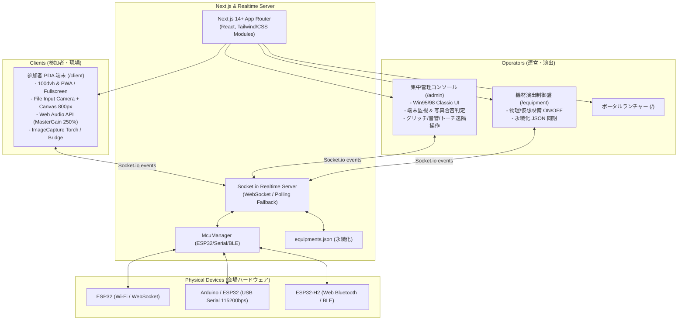

# 文化祭・工場点検ホラーアトラクションシステム Next.js 移行要件定義・完全仕様書

---

## 1. プロジェクト概要・背景

本システムは、文化祭・イベント等のアトラクションにおいて、参加者が携帯する **「工場保守用PDA（Webクライアント）」** と、運営スタッフが監視・演出発火を行う **「集中管理コンソール（Admin）」**、および会場内の物理ギミック（搬送コンベア、蒸気バルブ、非常灯、サーボモーター等）を制御する **「マイコン（ESP32 / Arduino / BLE）」** をリアルタイムに統合制御するWebアプリケーションである。

### 1.1 Next.js 移行の目的
- レガシーな Vanilla JS / 単一 `server.js` 構成から、**Next.js (App Router) + TypeScript + React** によるモダンで保守性の高いアーキテクチャへの刷新。
- 画面ごとの型安全なコンポーネント設計（Admin / Client / Equipment / Portal）。
- 演出・ハードウェア連携・実機依存の試行錯誤ノウハウ（カメラ、トーチ、音響、Viewport、Safe-area）を100%忠実に再現・永続化する。

---

## 2. システム全体アーキテクチャ



---

## 3. 画面仕様・UI/UX デザイン要件

### 3.1 共通デザインシステム（Industrial Retro / Windows 95/98 Classic）
- **フォント**: `"MS Gothic", "MS PGothic", "Yu Gothic", monospace`（レトロ業務機テイスト）。
- **基本パレット**:
  - ウィンドウ背景: `#d4d0c8` / `#c0c0c0`
  - タイトルバー: `linear-gradient(90deg, #000080, #1084d0)`、文字色 `#ffffff`、フォント太字
  - 3D ベベル境界線:
    - 凸 (Button/Window): `border-top: 2px solid #ffffff; border-left: 2px solid #ffffff; border-right: 2px solid #404040; border-bottom: 2px solid #404040;`
    - 凹 (Inset/Input/Display): `border-top: 2px solid #404040; border-left: 2px solid #404040; border-right: 2px solid #ffffff; border-bottom: 2px solid #ffffff;`
- **画面共通要件（管理と設備の独立性）**:
  - `Admin` と `Equipment` は同一のデザインテイストを踏襲するが、**コード上のコンポーネント共通化は行わず、保守性・独立した改修のため分離**する。
  - 各画面右上に全画面切替ボタン（`⛶ 全画面` / `縮小`）を配置。

---

### 3.2 参加者用 PDA 端末 (`/client`)

#### 画面構成 & フェーズ遷移
1. **`INIT` フェーズ（待機・初期化画面）**:
   - 4桁のランダム端末ID生成（URLクエリ `?deviceId=XXXX` があれば優先）。
   - 「安全規定への同意」チェックボックス（ONにしないと開始ボタンが押せないバリデーション）。
   - 「点検業務を開始」ボタン押下時に以下を同時実行:
     - Web Audio API のオーディオコンテキスト解放（ユーザーインタラクション制限解除）。
     - フルスクリーン化（ブラウザ制限・ノッチ・タブバー見切れ対策）。
     - WakeLock（スリープ防止）取得。
     - サーバーへ `device:ready` / `device:start_inspection` を送信。
   - **注意点**: `INIT` 中の端末は、管理者が一斉演出（`gm:trigger_effect`, `gm:emergency_all_light`）を発火しても、ネタバレ防止のためエフェクト受信対象から除外（スキップ）する。
2. **`ZONE1` フェーズ（品質管理室 - 写真点検）**:
   - 3箇所の点検タスクリスト（タスク1〜3）。
   - 各タスク選択 → 「📷 写真を撮影して提出」ボタン。
   - 提出後のステータスバッジ（`[送信中]` / `[審査中]` / `[合格]` / `[要再点検]`）。
   - 合格時に不穏な画面ノイズ・バイブレーション・怪音が発生。
3. **`ZONE2` フェーズ（第零製造ライン - 機器操作）**:
   - 搬送コンベア制御ボタン（ON/OFF トグル）。
   - 蒸気バルブ減圧ボタン（ON/OFF トグル）。
   - 操作時に Socket 経由で ESP32 の物理リレー/サーボと即時連動。
4. **`END` フェーズ（業務終了・怪異シャットダウン）**:
   - 「システム異常」「緊急停止」全画面赤/黒暗転オーバーレイ。
   - 電源遮断音（Power Down）再生、フラッシュライト強制消灯、操作受付停止。

#### PDA 固有のハードウェア・ブラウザ試行錯誤対策ノウハウ
1. **カメラ撮影の確実性**:
   - `getUserMedia` での生ビデオ描画は低価格Androidタブレットや特定WebViewでハング・クラッシュするため、`<input type="file" accept="image/*" capture="environment">` を採用。
   - `change` イベント受信後、`FileReader` + `HTML5 Canvas` により最大長辺を **800px (または640px)** にリサイズ、`image/jpeg (quality: 0.7)` に圧縮して Base64 送信。通信負荷を極小化。
2. **フラッシュライト（背面トーチ）制御の多重フォールバック**:
   - 第1優先: Android WebView の JavascriptInterface (`window.Android.turnOnFlash()`, `turnOffFlash()`, `toggleFlash()`)。
   - 第2優先: Web標準 `ImageCapture` / `MediaStreamTrack.applyConstraints({ advanced: [{ torch: true }] })`。
   - 第3優先（非対応環境）: 画面全体を白く高速点滅させる CSS スクリーンフラッシュフォールバック。
   - 点滅演出 (`flicker`): 引数 `count`（回数）と `intervalMs`（間隔ms）による非同期ループ処理。
3. **Viewport & Safe Area（タブレット・ノッチ・キーボード対策）**:
   - `height: 100dvh` を使用し、ブラウザアドレスバーの伸縮によるスクロール崩れを防止。
   - `padding-top: env(safe-area-inset-top, 0px)` によりパンチホールカメラ・上部タブの見切れを完全に防止。
   - 入力フィールドフォーカス時に `scrollIntoView({ behavior: 'smooth', block: 'center' })` を実行し、ソフトウェアキーボードによる入力隠れを防止。
4. **オーディオ音量ブースト**:
   - Web Audio API の `MasterGainNode` を使用し、端末の物理音量限界を超えて **最大 2.5倍 (250%)** までゲイン増幅（管理側から `effect:volume` で一括ブースト可能）。
   - オーディオ初期化は `pointerdown` / `keydown` の最初のキャプチャフェーズで確実にアンロック。
5. **バッテリー残量監視**:
   - `navigator.getBattery()` または `window.Android.getBatteryLevel()` を監視し、5秒ごとにサーバーへ同期（管理コンソールに `%` 表示）。

---

### 3.3 集中管理コンソール (`/admin`)

#### 3カラム構成
1. **左カラム: 接続端末監視 (Device Monitor)**:
   - オンライン端末を上位に自動ソート。
   - 端末ごとの「フェーズ切替ドロップダウン (`INIT`, `ZONE1`, `ZONE2`, `END`)」。
   - バッテリー残量・充電状態アイコン。
   - 個別グリッチボタン、個別初期化ボタン（初期化でランダムIDを再割り当て）。
2. **中央カラム: 点検写真レビューキュー (Photo Review Queue)**:
   - PDAから送信された写真のサムネイル一覧。
   - 10秒以内の重複送信はサーバー側で自動デバウンス（同一タスク多重投稿防止）。
   - 審査アクション:
     - `[ 合格 ]`: 端末へ承認通知 → 端末側で合格音＋タスク完了＋ノイズ付与。
     - `[ 不合格 (不鮮明) ]`: 「画像が不鮮明（ブレ・暗所）」理由で差し戻し。
     - `[ 不合格 (箇所違い) ]`: 「指定された点検箇所と異なります」理由で差し戻し。
3. **右カラム: 演出トリガー・機材制御 (Master Effects & Hardware Control)**:
   - 一括フェーズ強制切替（全端末 `ZONE1`, `ZONE2`, `END`）。
   - グリッチ演出（Level 1〜3 / 時間指定 / モード: `violent` 激しい, `creepy` 不穏）。
   - プロシージャル音響トリガー（ビープ、ガイガーカウンター、異常音、環境ドローン、モーター音、電源遮断音）。
   - 音量一括制御（100%, 150%, 200%, 250%）。
   - 背面トーチ遠隔点滅・点灯・消灯。
   - 非常用全照明（ESP32リレー＋全端末トーチ強制全点灯）。

---

### 3.4 機材管理パネル (`/equipment`)

- 物理設備および演出ギミックの登録・削除・一覧管理・遠隔操作。
- **データ永続化**: `equipments.json` とサーバーメモリを双方向同期。サーバー再起動時にも登録設備が消失しない設計。
- **全端末共通化**: どのPC/タブレットのブラウザから設備を追加・削除・操作しても、Socket.io の `equipment:init`, `equipment:add`, `equipment:remove` により即座に同期。

---

## 4. プロシージャル音響エンジン仕様 (`SoundEngine`)

外部音声ファイル（mp3/wav）のロード失敗・遅延を避けるため、**Web Audio API による完全動的波形合成**を採用。

| 音響プリセット | 合成アルゴリズム・構成ノード | パラメータ・効果 |
| :--- | :--- | :--- |
| **Beep (確認音)** | `OscillatorNode (sine)` + `BiquadFilter (bandpass)` | 880Hz, 0.06s, アタック0.003s。操作レスポンス用 |
| **Shutter (撮影音)** | `Noise (white)` + `BiquadFilter (1700-2900Hz)` | 2段階のメカニカルクリック音 (0.045s間隔) |
| **Low Impact (重低音)** | `OscillatorNode (sine 74Hz->27Hz)` + `Noise (brown lowpass 145Hz)` | 心臓に響く衝撃・怪異発生時の恐怖演出 |
| **Geiger (放射線/異変)** | `AudioBuffer (white noise burst)` + ランダム間隔スケジュール | 密度（level 1〜5）に応じた不規則なガイガーカウンター音 |
| **Drone (環境異常音)** | 複数 `OscillatorNode` (三角波/鋸歯状波) + LFO デチューン + リバーブ | 空間の歪み・不穏な金属共鳴音 |
| **Motor (機械稼働)** | `OscillatorNode (sawtooth 40Hz)` + PWMモジュレーション | 搬送コンベア・蒸気バルブ動作音 |
| **Power Down (遮断)** | ピッチ急降下オシレーター + 1/f ブラウンノイズフェードアウト | システム完全停止演出 |
| **Master Bus** | `GainNode (Input)` → `ConvolverNode (Room Reverb 2.7s)` + `Compressor` → `MasterGain (1.0〜2.5x)` | 閉鎖空間（工場内）の反響音と音量増幅 |

---

## 5. 通信プロトコル仕様 (Socket.io Event Specification)

### 5.1 Client ↔ Server

| イベント名 | 送信元 | ペイロード | 説明 |
| :--- | :--- | :--- | :--- |
| `device:ready` | Client | `{ deviceId: string, phase: string }` | 端末接続通知 |
| `device:start_inspection` | Client | `{ deviceId: string }` | 点検開始（INIT → ZONE1） |
| `device:battery_update` | Client | `{ deviceId: string, batteryLevel: number\|string, charging: boolean }` | 電池残量同期 |
| `device:flash_state` | Client | `{ deviceId: string, flashState: boolean }` | トーチ点灯状態報告 |
| `task:photo_submit` | Client | `{ deviceId: string, taskId: number, taskTitle: string, imageBase64: string }` | 点検写真提出 |
| `machine:control` | Client | `{ machineId: string, state: boolean, deviceId: string }` | 機器操作（コンベア/バルブ） |
| `phase:update` | Server | `{ phase: string, deviceId: string }` | フェーズ強制変更 |
| `task:review_result` | Server | `{ submissionId: string, taskId: number, status: 'APPROVED'\|'REJECTED', reason?: string }` | 写真審査結果 |
| `effect:glitch` | Server | `{ level: number, duration: number, vibrate: boolean, mode: 'violent'\|'creepy' }` | 画面グリッチ・ノイズ |
| `effect:torch` | Server | `{ state: boolean, flicker: boolean, count: number, intervalMs: number }` | トーチ点灯・点滅指令 |
| `effect:sound` | Server | `{ soundType: string, level?: number }` | プロシージャル音響再生 |
| `effect:volume` | Server | `{ volume: number }` | 音量ゲイン変更 (0.0〜2.5) |
| `effect:shutdown` | Server | `{}` | 緊急シャットダウン発火 |

### 5.2 Admin / Equipment ↔ Server

| イベント名 | 送信元 | ペイロード | 説明 |
| :--- | :--- | :--- | :--- |
| `admin:join` | Admin | `{}` | 管理コンソール入室 |
| `admin:get_state` | Admin | `{}` | 全端末・設備状態の即時取得 |
| `admin:review_photo` | Admin | `{ submissionId: string, status: 'APPROVED'\|'REJECTED', reason?: string }` | 写真合否判定 |
| `admin:override_phase` | Admin | `{ targetDeviceId?: string, phase: string }` | フェーズ個別/一括変更 |
| `admin:trigger_effect` | Admin | `{ targetDeviceId?: string, effectType: string, options: any }` | 演出トリガー |
| `admin:emergency_all_light`| Admin| `{}` | 全照明・全トーチ一斉点灯 |
| `equipment:get_all` | Equip | `{}` | 設備一覧取得 |
| `equipment:add` | Equip | `{ id: string, name: string, type: string, topic?: string, ... }` | 設備新規登録 |
| `equipment:remove` | Equip | `{ id: string }` | 設備削除 |
| `equipment:control` | Equip | `{ id: string, action: string, value: any }` | 設備状態切替 |

---

## 6. Next.js 移行プロジェクト構成案

Next.js 14+ (App Router) + TypeScript + カスタム Node.js サーバー構成。

```text
2026gionsai-next/
├── server/                      # リアルタイム通信バックエンド
│   ├── index.ts                 # Express / HTTP / HTTPS + Socket.io サーバー
│   ├── mcu-manager.ts           # マイコン統合管理 (Serial, BLE, Wi-Fi)
│   ├── store.ts                 # メモリ内状態管理 & 重複排除 (10s window)
│   └── persistence.ts           # equipments.json 読み書き
├── src/
│   ├── app/                     # Next.js App Router
│   │   ├── layout.tsx           # 全体共通ルートレイアウト (メタタグ・フォント)
│   │   ├── page.tsx             # ポータルランチャー (/)
│   │   ├── client/
│   │   │   └── page.tsx         # 参加者用PDA端末 (/client)
│   │   ├── admin/
│   │   │   └── page.tsx         # 集中管理コンソール (/admin)
│   │   └── equipment/
│   │       └── page.tsx         # 機材管理パネル (/equipment)
│   ├── components/
│   │   ├── admin/               # Win95風 管理コンポーネント群 (独立実装)
│   │   │   ├── DeviceMonitor.tsx
│   │   │   ├── PhotoReviewQueue.tsx
│   │   │   └── EffectTriggerPanel.tsx
│   │   ├── client/              # PDA 端末コンポーネント群
│   │   │   ├── PhaseInit.tsx
│   │   │   ├── PhaseZone1.tsx
│   │   │   ├── PhaseZone2.tsx
│   │   │   ├── PhaseEnd.tsx
│   │   │   └── HorrorCanvasOverlay.tsx
│   │   ├── equipment/           # 機材制御コンポーネント群 (独立実装)
│   │   │   └── EquipmentGrid.tsx
│   │   └── common/
│   │       └── FullscreenButton.tsx
│   ├── hooks/
│   │   ├── useSocket.ts         # Socket.io 接続 & イベント購読フック
│   │   ├── useTorch.ts          # Android Bridge & Web Torch 抽象化フック
│   │   ├── useBattery.ts        # 電池残量監視フック
│   │   └── useSoundEngine.ts    # Web Audio API プロシージャル音響フック
│   ├── lib/
│   │   ├── soundEngine.ts       # プロシージャル音響コアロジック (TypeScript)
│   │   └── types.ts             # 状態・Socketイベントの全型定義
│   └── styles/
│       ├── globals.css          # リセット & 100dvh & Safe-area 定義
│       ├── win95.css            # Windows 95/98 ベベル・配色トークン
│       └── glitch.css           # ホラーノイズ・CRTシェーダーアニメーション
├── data/
│   └── equipments.json          # 設備永続化ファイル
├── package.json
├── tsconfig.json
└── next.config.mjs
```

---

## 7. 実装・移行フェーズ計画

1. **フェーズ 1: 型定義 & コアライブラリの TypeScript 化**
   - Socket イベントペイロード、機器ステータス、タスク型を `types.ts` に定義。
   - `SoundEngine` を TypeScript クラスとして移植。
2. **フェーズ 2: リアルタイムサーバー構築**
   - Next.js と同居可能な Node.js カスタムサーバー、またはスタンドアロン Socket.io サーバーの実装。
   - `mcu-manager.ts` の移植と `equipments.json` 永続化の確実化。
3. **フェーズ 3: PDA クライアント (`/client`) の React/Next.js 実装**
   - `useTorch`, `useBattery`, `useSoundEngine` フックの実装。
   - `<input type="file">` + Canvas リサイズコンポーネントの実装。
   - 各ゾーンのステートマシン構築（`INIT` → `ZONE1` → `ZONE2` → `END`）。
4. **フェーズ 4: 管理画面 (`/admin`) & 設備画面 (`/equipment`) の実装**
   - Windows 95/98 Classic UI の再現。
   - 共通化せず独立コンポーネントとして保守性高く構築。
5. **フェーズ 5: 実機テスト & 結合検証**
   - Android/iOS 実機でのカメラ撮影・トーチ点滅・音量増幅テスト。
   - 複数端末同時接続時の負荷検証・写真審査レイテンシ確認。
